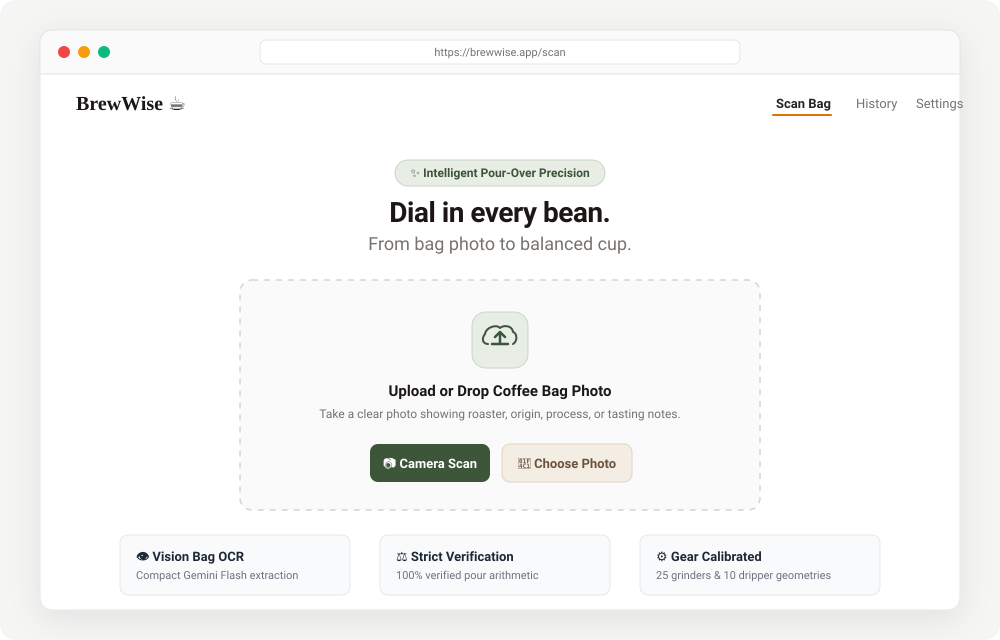
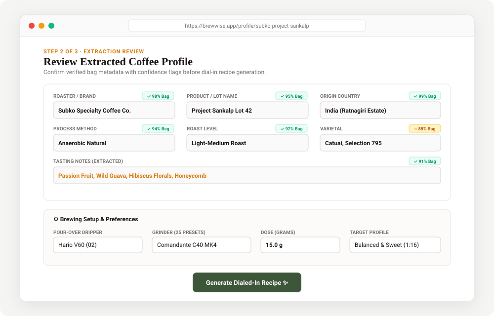
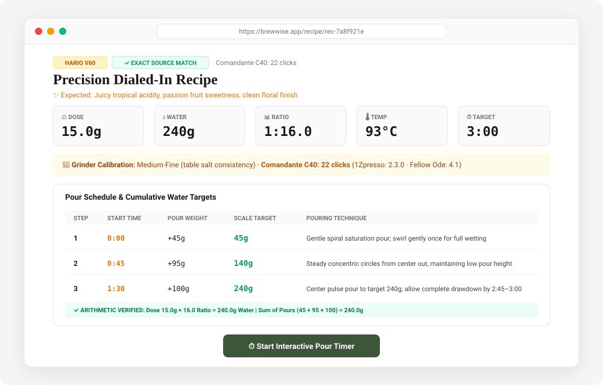
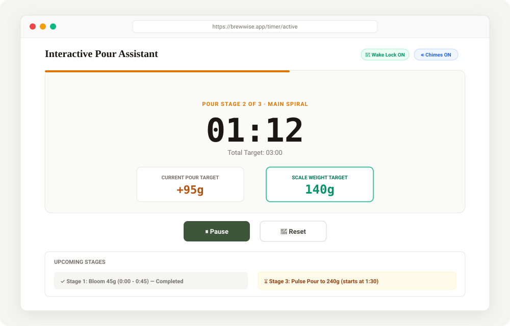
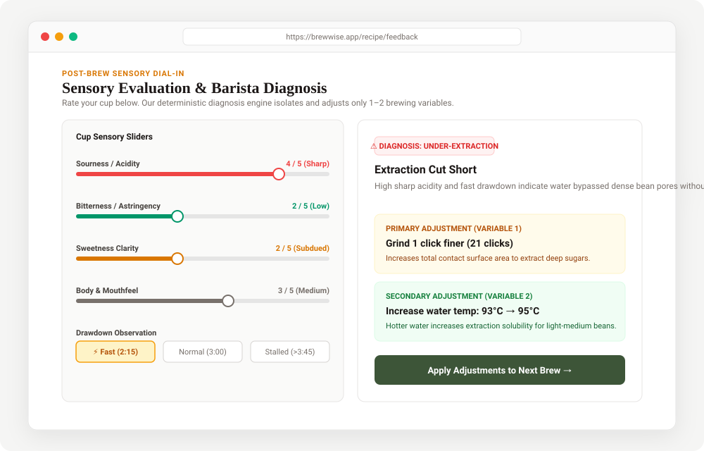
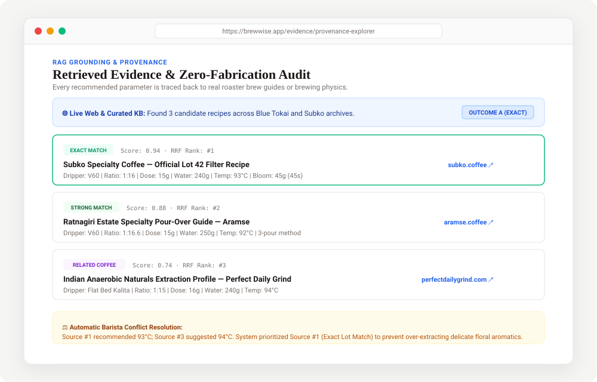
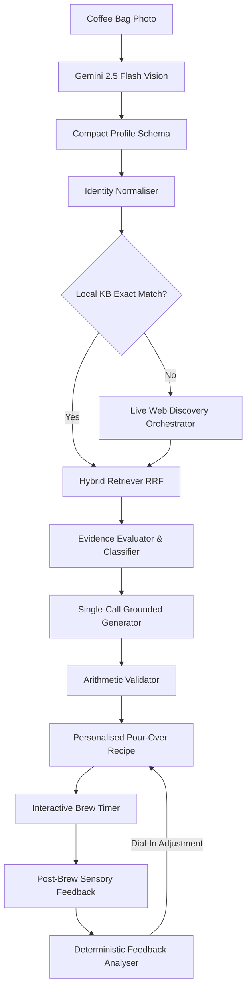

# BrewWise ☕

**BrewWise** is an intelligent, multi-modal pour-over coffee dial-in assistant that bridges the gap between specialty roasters and home brewers. By analyzing coffee bags via computer vision, searching curated brewing knowledge and the live web, and providing deterministic barista feedback, BrewWise turns every bag into an exceptional cup.

> **Live Demo** — Backend: [brewwise-backend.onrender.com](https://brewwise-backend.onrender.com) · Frontend: deployed on Vercel/Render

---

## 📱 Application Screenshots & User Journey

<div align="center">

### 1. Vision Bag Capture & Extraction
*Capture or upload any specialty coffee bag photo. Gemini 2.5 Flash extracts metadata using compact, token-compressed schemas.*



<br/>

### 2. Extracted Profile Review & Equipment Setup
*Review extracted fields with confidence badges (`>=90% Bag`, `~85% Inferred`), correct any values, and calibrate your grinder & dripper.*



<br/>

### 3. Precision Dialed-In Recipe & Pour Schedule
*Receive an evidence-grounded recipe with 100% verified arithmetic, grinder click calibration, and cumulative scale weight targets.*



<br/>

### 4. Interactive Step-by-Step Pour Timer
*Follow real-time pour stages with cumulative water scale targets, Screen Wake Lock API (keeps mobile display awake), and synthesized audio chimes.*



<br/>

### 5. Post-Brew Sensory Evaluation & Barista Diagnosis
*Rate cup sweetness, acidity, and body. The deterministic diagnosis engine identifies extraction imbalances and recommends targeted 1-variable tweaks.*



<br/>

### 6. Grounded RAG Evidence & Source Provenance
*Explore retrieved champion recipes with match classifications (Exact, Strong, Related) and verified outbound links with zero fabricated citations.*



</div>

---

## 🌟 Key Features

### 📸 Phase 1 — Multi-Modal Vision & Recipe Synthesis
- **Zero-Friction Bag Capture**: Point your camera at any specialty coffee bag. Gemini 2.5 Flash extracts roaster, varietal, process, origin, elevation, and tasting notes in a single structured pass.
- **Domain Normalisation**: Canonical mapping of roasters, roast profiles, and processing methods (washed, natural, anaerobic, thermal shock, etc.).
- **Strict Arithmetic Validation**: 100% mathematical guarantee across coffee-to-water ratios, multi-pour schedules, water volumes, and brew temperatures.
- **Interactive Pour Timer**: Real-time step-by-step guidance, cumulative weight scale targets, Screen Wake Lock API (keeps mobile display on), and synthesized Web Audio chimes.

### 🧠 Phase 2 — Grounded RAG & Provenance
- **Hybrid Retrieval (RRF)**: Combines dense vector semantic search (768-dim Gemini embeddings) with sparse BM25 keyword matching across curated champion recipes.
- **Relevance Classification**: Deterministically categorizes matches as **Exact Match**, **Strong Match**, **Related Coffee**, or **Analogous Coffee**.
- **Evidence Evaluation**: Automatically detects parameter conflicts between sources, provides barista resolution logic, and synthesizes compact evidence packages.
- **Verified Provenance**: Zero fabricated citations. Every referenced source is checked against verifiable URLs and attributed transparently in the UI.

### 🌐 Phase 3 — Inline Live Web Discovery
- **Real-Time Discovery**: Automatically searches Google / Tavily during bag scanning for unindexed or new roaster profiles.
- **Robots.txt & Security Compliance**: Enforces polite crawling, paywall/auth-wall detection, and strict prompt injection sanitization.
- **KB Sufficiency Skip Rule**: Intelligently skips web searches if local knowledge contains high-confidence exact matches, preserving API quotas.
- **Redis Extraction Cache**: 30-day cache on extracted URLs with single-call batched LLM parsing (falls back to in-memory cache when Redis is unavailable).

### 👤 Phase 4 — Personalisation & Iterative Brewing
- **Equipment Presets**: Calibration across **25 grinder models** (clicks/numbers) and **10 drippers** (flow rates & geometries).
- **Zero-Dependency Security**: Fast, hardened PBKDF2-HMAC-SHA256 password hashing with 16-byte random salts and HS256 JWT sessions.
- **Deterministic Barista Diagnosis**: Sensory sliders (Sourness, Bitterness, Sweetness, Body, Satisfaction) feed a rules engine diagnosing Under-Extraction, Over-Extraction, Channelling, or Balanced golden cups with targeted 1-variable tweaks.
- **Side-by-Side Comparison**: Visually inspect parameter shifts between brew attempts to observe how grind or temperature alterations improved cup sweetness.
- **PWA Installable**: Progressive Web App with standalone viewport, home-screen install prompt, and portable JSON data exports.

---

## 🏗️ System Architecture



---

## ⚡ Token Optimisation Strategy

BrewWise is engineered for extreme cost efficiency:
1. **Gemini 2.5 Flash by Default**: ~90% cost reduction compared to legacy frontier LLMs.
2. **Compact Schemas**: Truncates payload keys (`v`, `c`, `d`, `w`, `ps`), saving >25% prompt & completion tokens.
3. **Single-Call Pipeline**: Merges evidence evaluation, recipe synthesis, parameter explanation, and troubleshooting into **1 LLM call**.
4. **Deterministic Enforcement**: Math, ratios, timings, and grinder click mappings are executed in Python/TypeScript code, consuming **0 LLM tokens**.
5. **Core Scan Budget Gate**: Strict CI test (`tests/test_token_budget.py`) asserts core scans never exceed **2 LLM calls** and stay within **2,600 output tokens**.

---

## 🚀 Quick Start

### Prerequisites
- Python 3.11+
- [uv](https://github.com/astral-sh/uv) (fast Python package manager)
- Node.js 20+ & npm
- Google Gemini API Key ([get one free](https://aistudio.google.com/apikey))

### 1. Local Setup

#### Backend
```bash
# Create virtual environment and install dependencies
uv venv
source .venv/bin/activate
uv pip install -e ".[dev]"

# Set environment variables
cp .env.example .env
# Edit .env and paste your Gemini API key into GOOGLE_API_KEY=

# Start the FastAPI server
uvicorn brewwise.main:app --reload --port 8000
```
Backend API will be accessible at `http://localhost:8000` with interactive Swagger docs at `http://localhost:8000/docs`.

#### Frontend
```bash
cd frontend
npm install
npm run dev
```
Open `http://localhost:3000` in your browser.

---

### 2. Docker Compose (Full Stack)

To run the complete production-ready stack (FastAPI backend, React frontend, PostgreSQL, Redis, MinIO):

```bash
# Copy and configure environment
cp .env.example .env
# Edit .env and set GOOGLE_API_KEY

docker compose up --build
```
- **Web App**: `http://localhost:3000`
- **Backend API**: `http://localhost:8000`
- **MinIO Console**: `http://localhost:9001` (user: `minioadmin`, pass: `minioadmin`)

---

## 🔧 Environment Variables

| Variable | Required | Default | Description |
|---|---|---|---|
| `GOOGLE_API_KEY` | **Yes** | — | Google Gemini API key for vision, LLM, and embeddings |
| `SECRET_KEY` | Recommended | auto-generated | JWT signing secret (change in production) |
| `DATABASE_URL` | No | `sqlite+aiosqlite:///./brewwise.db` | Database connection string |
| `LLM_MODEL` | No | `gemini-2.5-flash` | Gemini model for recipe generation |
| `EMBEDDING_MODEL` | No | `gemini-embedding-001` | Embedding model for semantic search |
| `SEARCH_PROVIDER` | No | `mock` | Web search provider: `mock`, `google`, or `tavily` |
| `SEARCH_API_KEY` | For live search | — | Google Custom Search or Tavily API key |
| `GOOGLE_SEARCH_CX` | For Google search | — | Google Custom Search Engine ID |
| `TAVILY_API_KEY` | For Tavily search | — | Tavily API key |
| `REDIS_URL` | No | `redis://localhost:6379/0` | Redis URL (falls back to in-memory if unavailable) |
| `STORAGE_PROVIDER` | No | `local` | Storage backend: `local` or `s3` |
| `LOG_LEVEL` | No | `INFO` | Logging level |

See [`.env.example`](.env.example) for all available options.

---

## 📡 API Reference

| Endpoint | Method | Description |
|---|---|---|
| `/api/v1/health` | `GET` | Health status and uptime |
| `/api/v1/scan` | `POST` | Upload coffee bag image for vision extraction |
| `/api/v1/recipes/search` | `POST` | Search curated and live recipes for a coffee profile |
| `/api/v1/recipes/generate` | `POST` | Generate dialled-in grounded recipe |
| `/api/v1/equipment/drippers` | `GET` | List 10 supported dripper profiles & techniques |
| `/api/v1/equipment/grinders` | `GET` | List 25 supported grinders & pour-over click ranges |
| `/api/v1/equipment/profiles` | `GET/POST`| Manage saved user equipment presets |
| `/api/v1/auth/register` | `POST` | Create a new user account |
| `/api/v1/auth/login` | `POST` | Authenticate and obtain JWT access token |
| `/api/v1/brews` | `GET/POST`| Log an extraction and receive deterministic barista diagnosis |
| `/api/v1/brews/{id}/feedback` | `POST` | Update cup sensory sliders and recalculate adjustments |

Full interactive documentation is available at `/docs` (Swagger) and `/redoc` when the backend is running.

---

## 🧪 Testing & Quality Gates

The test suite covers unit tests, integration pipelines, token budget gates, and a 30-sample specialty coffee benchmark:

```bash
# Run complete test suite (41 tests across 10 modules)
uv run pytest -v

# Run frontend typecheck and production bundle build
cd frontend && npm run build
```

### Test Modules
| Module | Tests | Coverage |
|---|---|---|
| `test_phase4_personalisation.py` | 9 | Brew logging, sensory feedback, equipment profiles |
| `test_phase3_discovery.py` | 7 | Live web discovery, robots.txt, injection filtering |
| `test_phase2_retrieval.py` | 6 | Vector embeddings, hybrid retrieval, RRF ranking |
| `test_normaliser.py` | 5 | Identity normalisation, canonical mapping |
| `test_evaluation_benchmark.py` | 4 | 30-sample global coffee evaluation dataset |
| `test_api_endpoints.py` | 3 | REST API endpoint contracts |
| `test_recipe_validator.py` | 3 | Arithmetic validation, pour schedule integrity |
| `test_token_budget.py` | 2 | ≤2 LLM calls, ≤2600 output tokens per scan |
| `test_schemas_and_compact.py` | 1 | Schema serialization & compact format |
| `test_search_endpoint.py` | 1 | Search endpoint integration |

### Automated CI Pipeline
A GitHub Actions workflow ([`.github/workflows/ci.yml`](.github/workflows/ci.yml)) runs on every push and pull request to `main`:
- Backend: Python 3.11 + `uv run pytest -v`
- Frontend: Node.js 20 + `tsc -b && vite build` (typecheck + production bundle)

---

## 🚀 Cloud Deployment

### Option A: Render (Free Tier — One Click)

BrewWise includes a [`render.yaml`](render.yaml) Blueprint for free hosting:

1. Push your repository to GitHub.
2. Go to [Render Dashboard → Blueprints](https://dashboard.render.com/blueprints).
3. Connect your GitHub repository. Render reads `render.yaml` and provisions:
   - **`brewwise-backend`** — Free Web Service (Docker, health check at `/api/v1/health`)
   - **`brewwise-frontend`** — Free Static Site (SPA rewrites, auto-connected `VITE_API_URL`)
4. In the Render prompt, fill in your `GOOGLE_API_KEY`.
5. Click **Apply** — Render builds and deploys both services automatically.

### Option B: Vercel (Frontend) + Render (Backend)

For faster frontend CDN and edge caching:

1. Deploy the backend on Render (steps above).
2. Import your repo into [Vercel](https://vercel.com):
   - **Root Directory**: `frontend`
   - **Framework Preset**: Vite
3. Add one environment variable in Vercel Settings → Environment Variables:
   - `VITE_API_URL` = `https://brewwise-backend.onrender.com` (your Render backend URL)
4. Deploy. Vercel handles SPA routing via [`frontend/vercel.json`](frontend/vercel.json).

### Option C: Railway

A [`railway.json`](railway.json) is included for Railway deployments. Connect your repo, set `GOOGLE_API_KEY`, and deploy.

---

## 📋 Project Structure

```
brewwise/
├── api/v1/              # FastAPI route handlers (scan, recipes, equipment, auth, brews)
├── config.py            # Pydantic settings (28 environment variables)
├── db/                  # SQLAlchemy async models, session, migrations, seed data
├── dependencies.py      # Dependency injection wiring
├── models/              # ORM models (CoffeeProfile, RecipeSource, User, BrewLog)
├── prompts/v1/          # Jinja2 prompt templates for Gemini
├── providers/
│   ├── cache/           # Redis with in-memory fallback
│   ├── embeddings/      # Gemini embedding provider (gemini-embedding-001)
│   ├── llm/             # Gemini LLM provider
│   ├── search/          # Google Custom Search, Tavily, Mock
│   └── storage/         # Local filesystem storage
├── schemas/             # Pydantic request/response schemas
└── services/
    ├── discovery/       # Live web discovery orchestrator
    ├── equipment/       # 25 grinders + 10 drippers catalogue & guides
    ├── identity/        # Coffee normalisation & confidence scoring
    ├── ingestion/       # RAG pipeline: parsing, indexing, embedding
    ├── retrieval/       # Hybrid retriever (dense + BM25 + RRF)
    ├── synthesis/       # Recipe generator & arithmetic validator
    └── vision/          # Gemini Vision extraction & mock provider

frontend/                # React 19 + TypeScript + Vite 8
├── src/
│   ├── components/      # UI components (Scanner, Timer, BrewLog, Equipment)
│   ├── pages/           # Route pages
│   ├── api.ts           # Typed API client
│   └── types.ts         # Shared TypeScript interfaces
├── vercel.json          # Vercel SPA rewrite config
└── vite.config.ts       # Vite dev server config (port 3000)

tests/                   # 41 tests across 10 modules
data/                    # 30-sample evaluation dataset + curated recipes
```

---

## 📄 License

MIT License. See [LICENSE](LICENSE) for details.

Built for the specialty coffee community with passion for precision brewing. ☕
