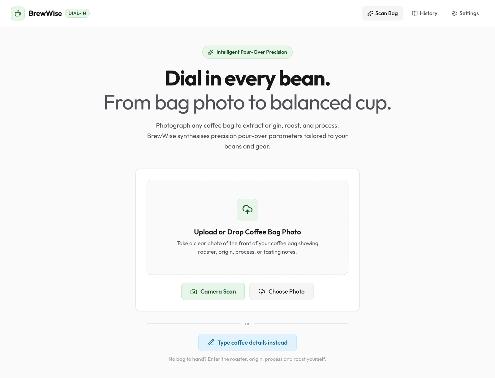
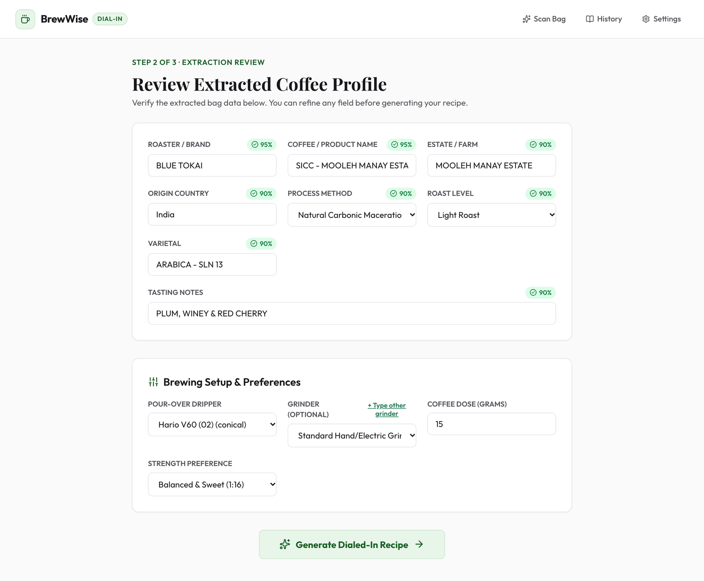
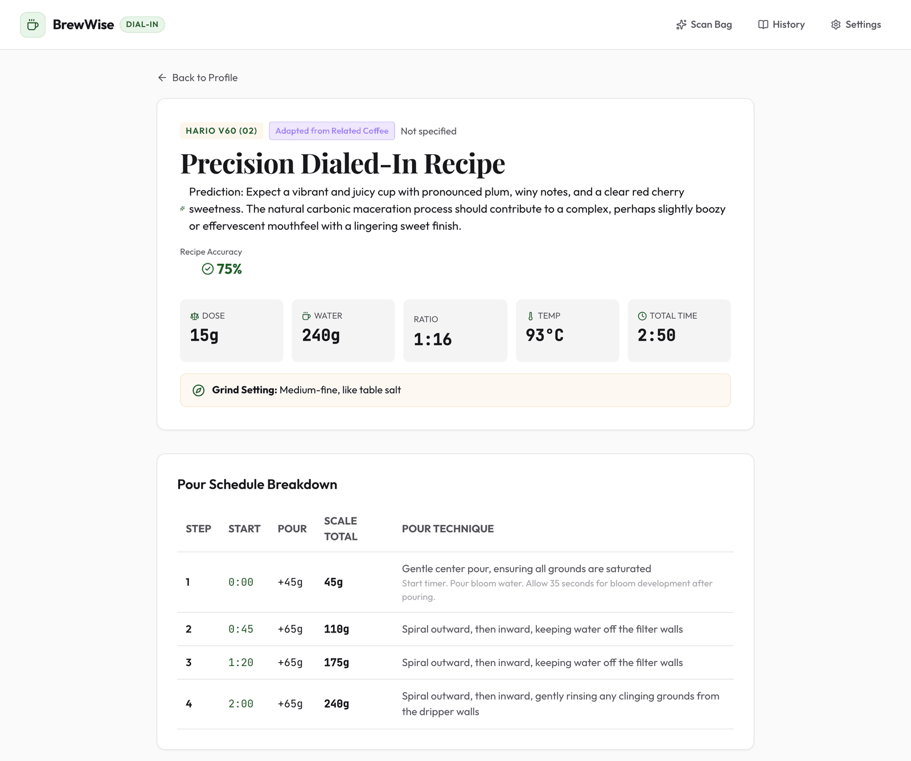
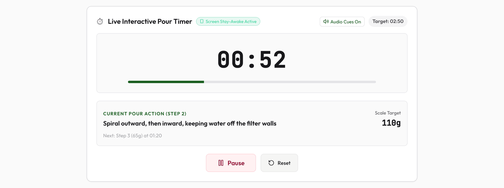
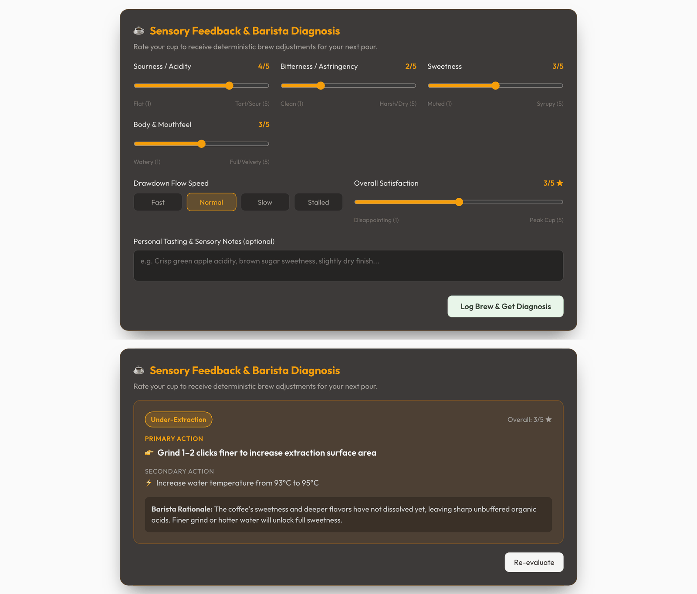
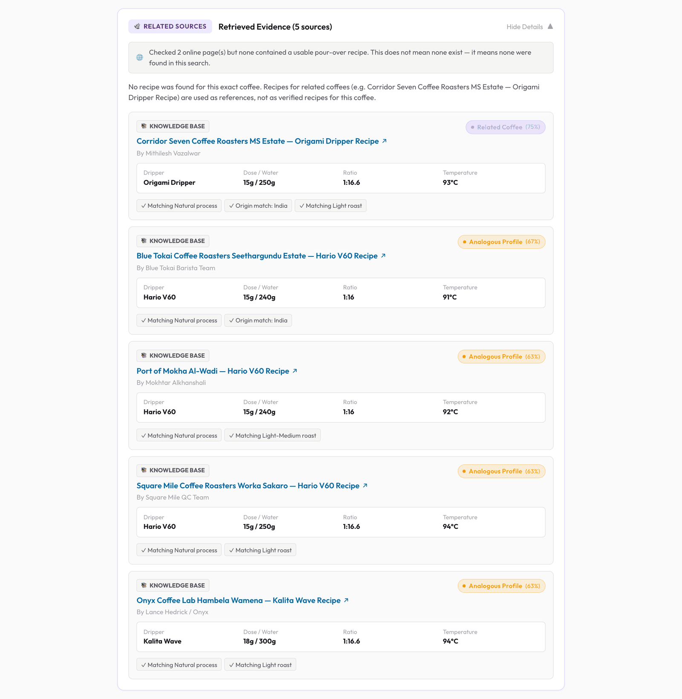
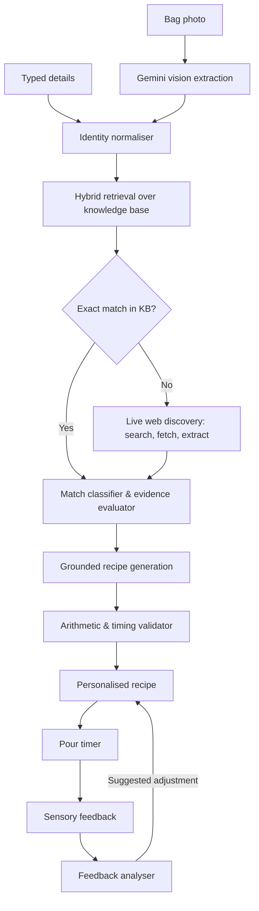

# BrewWise ☕

BrewWise turns a coffee bag into a pour-over recipe. Photograph the bag (or type the details in), and it reads the coffee's identity, looks for recipes other people have published for that coffee, and produces a recipe adapted to your dripper, grinder and dose — with the sources shown and anything it could not verify labelled as such.

> **Live demo** — [brew-wise.vercel.app](https://brew-wise.vercel.app/) · Backend API: [brewwise-backend.onrender.com](https://brewwise-backend.onrender.com) ([API docs](https://brewwise-backend.onrender.com/docs)). The backend runs on Render's free tier and sleeps when idle, so the first request can take a minute.

**Contents:** [What it does](#what-it-does) · [Screenshots](#screenshots) · [How it works](#how-it-works) · [Quick start](#quick-start) · [Configuration](#configuration) · [API reference](#api-reference) · [Testing](#testing) · [Deployment](#deployment) · [Project structure](#project-structure) · [Known limitations](#known-limitations) · [License](#license)

---

## What it does

- **Reads the bag.** Gemini vision extracts roaster, coffee name, estate, origin, varietal, process, roast level and tasting notes. Each field carries a confidence score, and anything missing or illegible stays *unknown* rather than being guessed.
- **Or skip the photo.** "Type coffee details instead" opens the same form for manual entry.
- **Finds existing recipes.** A hybrid search (embeddings + keyword overlap, merged with reciprocal rank fusion) runs over a curated knowledge base of 54 recipes. When a search provider is configured, it also searches the live web, fetches the pages and extracts any pour-over recipes they contain.
- **Says how close each match is.** Sources are classified as *exact*, *strong*, *related* or *analogous*. A recipe for a different lot from the same estate is a related reference, never an exact match.
- **Generates a personalised recipe.** Dose, water, ratio, temperature, grind, bloom, a timed pour schedule, step-by-step instructions and troubleshooting. Grinder click settings come from a catalogue of 25 grinders; an unknown grinder gets a relative grind description instead of an invented setting.
- **Checks its own arithmetic.** Every recipe is validated before display: pours must add up to the total water, the ratio must match dose and water, and the timings must be possible.
- **Shows where everything came from.** Each recipe is labelled as sourced, adapted from a related coffee, AI-generated, or rule-based. Cited sources are always records that were actually retrieved.
- **Helps you iterate.** A pour timer with audio cues and screen wake lock, a post-brew feedback form that diagnoses the cup and suggests one or two changes, brew history, and side-by-side comparison of attempts.

---

## Screenshots

All screenshots are captured from the running app, using a real bag scan (Blue Tokai, Mooleh Manay Estate).

### 1. Scan a bag — or type the details



### 2. Review the extracted profile and choose equipment

Confidence badges show how sure the extraction is. Every field is editable before generating.



### 3. Recipe and pour schedule



### 4. Pour timer



### 5. Post-brew feedback and diagnosis



### 6. Retrieved evidence

Each source shows its match type, its parameters and why it matched. The banner reports what the live web search did for this coffee.



---

## How it works



A few design choices worth knowing:

- **Live discovery is explicit.** The LLM is never assumed to have web access. A search provider returns URLs, pages are fetched (respecting `robots.txt`, skipping paywalls), and only then are recipes extracted. Search snippets are never treated as recipes.
- **Nothing is filled in.** A fetched page counts as a recipe only if it states a dose and a water quantity. Values the page does not state stay empty, and numbers reported by the LLM are rejected unless they appear in the page text.
- **Web content is untrusted.** Fetched text is sanitised for prompt-injection patterns and passed to the model as data, not instructions.
- **Rules where rules are enough.** Arithmetic, timing checks, grinder settings, match classification and feedback diagnosis are plain code. If the LLM is unavailable or returns an inconsistent recipe, a rule-based recipe is used and labelled as such.
- **Search failure is not "nothing found".** The UI distinguishes live search being unconfigured, failing, finding pages it could not read, and finding no recipes.

More detail: [`architecture.md`](architecture.md), [`implementation.md`](implementation.md), [`token_optimisation_strategy.md`](token_optimisation_strategy.md), and the original brief in [`problemstatement.md`](problemstatement.md).

---

## Quick start

### Prerequisites

- Python 3.11+ and [uv](https://github.com/astral-sh/uv)
- Node.js 20+ and npm
- A Google Gemini API key ([get one](https://aistudio.google.com/apikey))
- Optional: a [Tavily](https://tavily.com) API key for live web search

### Backend

```bash
uv venv
source .venv/bin/activate
uv pip install -e ".[dev]"

cp .env.example .env
# Edit .env: set GOOGLE_API_KEY, and optionally SEARCH_PROVIDER + TAVILY_API_KEY

uvicorn brewwise.main:app --reload --port 8000
```

The API runs at `http://localhost:8000`, with interactive docs at `http://localhost:8000/docs`. On first start it creates a SQLite database and loads the equipment catalogue and curated recipes.

### Frontend

```bash
cd frontend
npm install
npm run dev
```

Open `http://localhost:3000`. The dev server proxies `/api` to the backend on port 8000.

### Docker Compose

Runs the backend and frontend with PostgreSQL, Redis and MinIO:

```bash
cp .env.example .env   # set GOOGLE_API_KEY
docker compose up --build
```

- Web app: `http://localhost:3000`
- Backend API: `http://localhost:8000`
- MinIO console: `http://localhost:9001` (`minioadmin` / `minioadmin`)

---

## Configuration

All settings are environment variables, read from `.env` locally. See [`.env.example`](.env.example) for the full list.

| Variable | Default | Description |
|---|---|---|
| `GOOGLE_API_KEY` | — | **Required.** Gemini key used for bag scanning, recipe generation and embeddings. Without it, scanning returns an error and recipes are rule-based. |
| `SEARCH_PROVIDER` | `none` | Live web search: `tavily`, `google`, or `none`. With `none` (or a missing key) the app uses the knowledge base only and says so in the UI. |
| `TAVILY_API_KEY` | — | Required when `SEARCH_PROVIDER=tavily`. |
| `SEARCH_API_KEY`, `GOOGLE_SEARCH_CX` | — | Both required when `SEARCH_PROVIDER=google` (Programmable Search key and engine ID). |
| `LLM_MODEL` | `gemini-2.5-flash` | Model for vision and recipe generation. |
| `EMBEDDING_MODEL` | `gemini-embedding-001` | Model for semantic search. |
| `DATABASE_URL` | `sqlite+aiosqlite:///./brewwise.db` | Async SQLAlchemy URL. PostgreSQL is supported via `asyncpg`. |
| `REDIS_URL` | `redis://localhost:6379/0` | Cache. Falls back to an in-memory cache if Redis is unreachable. |
| `SECRET_KEY` | insecure dev value | JWT signing secret. **Set your own in production.** |
| `CORS_ORIGINS` | localhost ports | Comma-separated list of allowed frontend origins. |
| `MAX_UPLOAD_SIZE_MB` | `10` | Upload size limit for bag photos (JPEG, PNG or WebP). |
| `LIVE_DISCOVERY_ENABLED` | `true` | Master switch for live web search. |
| `LIVE_DISCOVERY_PERSIST` | `true` | Save recipes found online into the knowledge base. |
| `LIVE_DISCOVERY_TOTAL_TIMEOUT` | `15` | Seconds allowed for one live search, end to end. |
| `LIVE_DISCOVERY_MAX_URLS` | `5` | Pages fetched per search. |
| `LIVE_DISCOVERY_RATE_LIMIT` | `10` | Outbound searches allowed per minute. |
| `VISION_PROVIDER` | `gemini` | Set to `mock` only for offline UI demos: it returns one fixed sample profile for every image. |

The frontend takes one build-time variable, `VITE_API_URL` (the backend's URL). It is only needed when the frontend and backend are hosted separately.

---

## API reference

All routes are under `/api/v1`. Full interactive documentation is at `/docs` (Swagger) and `/redoc`.

| Endpoint | Method | Description |
|---|---|---|
| `/health` | `GET` | Health check |
| `/scan` | `POST` | Upload a bag photo; returns the extracted coffee profile |
| `/profiles` | `POST` | Create a profile from typed-in details (no photo) |
| `/profiles/{id}` | `GET`, `PUT` | Read or correct a coffee profile |
| `/recipes/search` | `POST` | Knowledge-base and live-web search for a profile; returns evidence with match types |
| `/recipes/generate` | `POST` | Generate a personalised recipe for a profile and equipment |
| `/recipes/{id}` | `GET` | Fetch a saved recipe |
| `/equipment/drippers`, `/equipment/grinders` | `GET` | Equipment catalogue |
| `/equipment/grind-setting` | `GET` | Grinder-specific setting for a relative grind size |
| `/equipment/profiles` | `GET`, `POST` | Saved equipment presets |
| `/equipment/profiles/{id}` | `PUT` | Update a preset |
| `/auth/register`, `/auth/login`, `/auth/me` | `POST`, `POST`, `GET` | Optional accounts (JWT) |
| `/brews` | `GET`, `POST` | Brew history; logging a brew returns a diagnosis |
| `/brews/{id}` | `GET` | One brew log |
| `/brews/{id}/feedback` | `POST` | Update feedback and recalculate the suggested adjustment |

---

## Testing

```bash
uv run pytest -v                 # 56 backend tests
cd frontend && npm run build     # type-check and production build
```

If `.env` contains a real `GOOGLE_API_KEY`, the integration tests that generate recipes call Gemini; expect the suite to take around 30 seconds instead of 2. Tests use the database configured in `DATABASE_URL`.

| Module | Tests | Covers |
|---|---|---|
| `test_integrity_guards.py` | 14 | Identity matching, no-fabrication rules for live extraction, recipe labelling, timing validation, upload type checks |
| `test_phase4_personalisation.py` | 9 | Brew logging, feedback diagnosis, equipment profiles |
| `test_phase3_discovery.py` | 7 | Live discovery outcomes, robots/paywall handling, injection filtering |
| `test_phase2_retrieval.py` | 6 | Embeddings, hybrid retrieval, match classification |
| `test_normaliser.py` | 5 | Roaster, process and roast normalisation |
| `test_api_endpoints.py` | 4 | Endpoint contracts, manual profile entry |
| `test_evaluation_benchmark.py` | 4 | 30-coffee evaluation dataset |
| `test_recipe_validator.py` | 3 | Recipe arithmetic |
| `test_token_budget.py` | 2 | LLM call and output-token budget per scan |
| `test_schemas_and_compact.py` | 1 | Compact extraction schema |
| `test_search_endpoint.py` | 1 | Search-then-generate flow |

**Evaluation dataset.** [`data/evaluation_dataset.json`](data/evaluation_dataset.json) holds 30 coffees spanning origins, processes and roast levels. `test_evaluation_benchmark.py` runs normalisation, query building, match classification and recipe validation across all of them.

**CI.** [`.github/workflows/ci.yml`](.github/workflows/ci.yml) runs the backend tests and the frontend build on every push and pull request to `main`.

---

## Deployment

### Render (backend + frontend)

[`render.yaml`](render.yaml) is a Blueprint that provisions both services on the free tier.

1. In the [Render dashboard](https://dashboard.render.com/blueprints), create a Blueprint from this repository.
2. When prompted, enter `GOOGLE_API_KEY`. To enable live web search, also enter `SEARCH_PROVIDER` (`tavily`) and `TAVILY_API_KEY`.
3. Apply. Render builds `brewwise-backend` (Docker) and `brewwise-frontend` (static site), and wires `VITE_API_URL` between them.

### Vercel (frontend) + Render (backend)

1. Deploy the backend on Render as above.
2. Import the repository into [Vercel](https://vercel.com) with **Root Directory** `frontend` and the **Vite** preset.
3. Set `VITE_API_URL` to your Render backend URL, then deploy. [`frontend/vercel.json`](frontend/vercel.json) handles client-side routing.

API keys belong on the backend only. The frontend never needs `GOOGLE_API_KEY` or a search key.

### Railway

[`railway.json`](railway.json) builds the backend from `Dockerfile.backend`. Set the same environment variables as for Render.

---

## Project structure

```
brewwise/
├── api/v1/          # Route handlers: scan, profiles & recipes, equipment, auth, brews
├── config.py        # Settings (environment variables)
├── dependencies.py  # Provider wiring
├── db/              # Session setup and equipment seed data
├── models/          # SQLAlchemy models
├── schemas/         # Pydantic request/response schemas
├── prompts/v1/      # Versioned Jinja2 prompt templates
├── providers/       # Swappable integrations
│   ├── llm/         #   Gemini
│   ├── embeddings/  #   Gemini embeddings
│   ├── search/      #   Tavily, Google Programmable Search
│   ├── cache/       #   Redis with in-memory fallback
│   └── storage/     #   Local filesystem
└── services/
    ├── vision/      # Bag extraction
    ├── identity/    # Normalisation and confidence
    ├── ingestion/   # Parsing, deduplication, indexing
    ├── retrieval/   # Hybrid retriever, match classifier, evidence evaluator
    ├── discovery/   # Live web search, page fetching, recipe extraction
    ├── synthesis/   # Recipe generator, validator, provenance check
    ├── equipment/   # Grinder and dripper catalogues
    └── feedback/    # Post-brew diagnosis

frontend/            # React 19 + TypeScript + Vite
└── src/
    ├── pages/       # Home, ProfileEdit, RecipeView, BrewHistory, Settings
    ├── components/  # ImageCapture, BrewTimer, FeedbackForm, EvidencePanel, ...
    ├── api.ts       # Typed API client
    └── types.ts     # Shared interfaces

data/                # Curated recipes and the evaluation dataset
scripts/             # Knowledge-base ingestion
tests/               # Backend test suite
```

---

## Known limitations

- **Live search depends on what sites allow.** Pages that block automated access, rate-limit, or sit behind a login are skipped, so a coffee with published recipes can still come back with none found.
- **The knowledge base is small.** 54 curated recipes; coffees outside it rely on live search or a generated starting recipe.
- **Recipes are starting points.** Expected flavour is a prediction, and grind settings vary between individual grinders.
- **Free-tier hosting is not persistent.** With SQLite on Render's free tier, saved profiles, recipes and brew history are lost when the service redeploys. Use PostgreSQL for anything you want to keep.
- **Feedback is per brew.** The diagnosis looks at one brew at a time; it does not yet take earlier attempts for the same coffee into account.
- **No per-user rate limiting** on the API.

---

## License

Released under the [MIT License](LICENSE).
