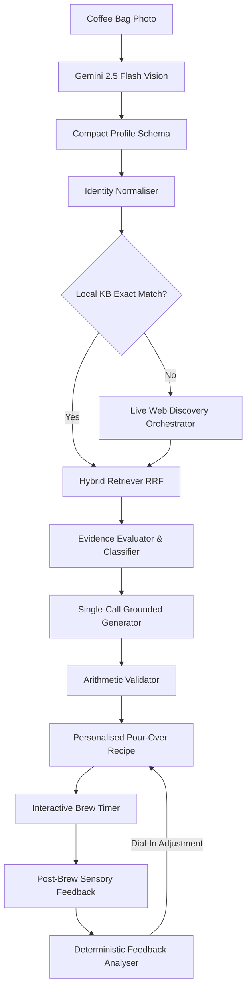

# BrewWise ☕

**BrewWise** is an intelligent, multi-modal pour-over coffee dial-in assistant that bridges the gap between specialty roasters and home brewers. By analyzing coffee bags via computer vision, searching curated brewing knowledge and the live web, and providing deterministic barista feedback, BrewWise turns every bag into an exceptional cup.

---

## 🌟 Key Features

### 📸 Phase 1 — Multi-Modal Vision & Recipe Synthesis
- **Zero-Friction Bag Capture**: Point your camera at any specialty coffee bag. Gemini 2.5 Flash extracts roaster, varietal, process, origin, elevation, and tasting notes in a single structured pass.
- **Domain Normalisation**: Canonical mapping of roasters, roast profiles, and processing methods (washed, natural, anaerobic, thermal shock, etc.).
- **Strict Arithmetic Validation**: 100% mathematical guarantee across coffee-to-water ratios, multi-pour schedules, water volumes, and brew temperatures.
- **Interactive Pour Timer**: Real-time step-by-step guidance, cumulative weight scale targets, Screen Wake Lock API (keeps mobile display on), and synthesized Web Audio chimes.

### 🧠 Phase 2 — Grounded RAG & Provenance
- **Hybrid Retrieval (RRF)**: Combines dense vector semantic search (768-dim Gemini embeddings) with sparse BM25 keyword matching across curated champion recipes.
- **Relevance Classification**: Deterministically categorizes matches as **Exact Match**, **Strong Match**, **Related Coffee**, or **Analogous Coffee**.
- **Evidence Evaluation**: Automatically detects parameter conflicts between sources, provides barista resolution logic, and synthesizes compact evidence packages.
- **Verified Provenance**: Zero fabricated citations. Every referenced source is checked against verifiable URLs and attributed transparently in the UI.

### 🌐 Phase 3 — Inline Live Web Discovery
- **Real-Time Discovery**: Automatically searches Google / Tavily during bag scanning for unindexed or new roaster profiles.
- **Robots.txt & Security Compliance**: Enforces polite crawling, paywall/auth-wall detection, and strict prompt injection sanitization.
- **KB Sufficiency Skip Rule**: Intelligently skips web searches if local knowledge contains high-confidence exact matches, preserving API quotas.
- **Redis Extraction Cache**: 30-day cache on extracted URLs with single-call batched LLM parsing.

### 👤 Phase 4 — Personalisation & Iterative Brewing
- **Equipment Presets**: Calibration across **21 grinder models** (clicks/numbers) and **10 drippers** (flow rates & geometries).
- **Zero-Dependency Security**: Fast, hardened PBKDF2-HMAC-SHA256 password hashing with 16-byte random salts and HS256 JWT sessions.
- **Deterministic Barista Diagnosis**: Sensory sliders (Sourness, Bitterness, Sweetness, Body, Satisfaction) feed a rules engine diagnosing Under-Extraction, Over-Extraction, Channelling, or Balanced golden cups with targeted 1-variable tweaks.
- **Side-by-Side Comparison**: Visually inspect parameter shifts between brew attempts to observe how grind or temperature alterations improved cup sweetness.
- **PWA & Offline Ready**: Installable Progressive Web App with standalone viewport and portable JSON data exports.

---

## 🏗️ System Architecture



---

## ⚡ Token Optimisation Strategy

BrewWise is engineered for extreme cost efficiency:
1. **Gemini 2.5 Flash by Default**: ~90% cost reduction compared to legacy frontier LLMs.
2. **Compact Schemas**: Truncates payload keys (`v`, `c`, `d`, `w`, `ps`), saving >25% prompt & completion tokens.
3. **Single-Call Pipeline**: Merges evidence evaluation, recipe synthesis, parameter explanation, and troubleshooting into **1 LLM call**.
4. **Deterministic Enforcement**: Math, ratios, timings, and grinder click mappings are executed in Python/TypeScript code, consuming **0 LLM tokens**.
5. **Core Scan Budget Gate**: Strict CI test (`tests/test_token_budget.py`) asserts core scans never exceed **2 LLM calls** and stay within **2,600 output tokens**.

---

## 🚀 Quick Start

### Prerequisites
- Python 3.11+
- [uv](https://github.com/astral-sh/uv) (fast Python package manager)
- Node.js 20+ & npm
- Google Gemini API Key

### 1. Local Setup

#### Backend
```bash
# Create virtual environment and install dependencies
uv venv
source .venv/bin/activate
uv pip install -e ".[dev]"

# Set environment variables
export GOOGLE_API_KEY="your-gemini-api-key"
export SECRET_KEY="your-random-jwt-secret"

# Start the FastAPI server
uvicorn brewwise.main:app --reload --port 8000
```
Backend API will be accessible at `http://localhost:8000` with interactive Swagger docs at `http://localhost:8000/docs`.

#### Frontend
```bash
cd frontend
npm install
npm run dev
```
Open `http://localhost:5173` in your browser.

---

### 2. Docker Compose (Full Stack)

To run the complete production-ready stack (FastAPI backend, React frontend, PostgreSQL + pgvector, Redis, MinIO):

```bash
docker compose up --build
```
- **Web App**: `http://localhost:3000`
- **Backend API**: `http://localhost:8000`
- **MinIO Console**: `http://localhost:9001` (user: `minioadmin`, pass: `minioadmin`)

---

## 📡 API Reference Overview

| Endpoint | Method | Description |
|---|---|---|
| `/api/v1/health` | `GET` | Health status and uptime |
| `/api/v1/scan` | `POST` | Upload coffee bag image for vision extraction |
| `/api/v1/recipes/search` | `POST` | Search curated and live recipes for a coffee profile |
| `/api/v1/recipes/generate` | `POST` | Generate dialled-in grounded recipe |
| `/api/v1/equipment/drippers` | `GET` | List 10 supported dripper profiles & techniques |
| `/api/v1/equipment/grinders` | `GET` | List 21 supported grinders & pour-over click ranges |
| `/api/v1/equipment/profiles` | `GET/POST`| Manage saved user equipment presets |
| `/api/v1/auth/register` | `POST` | Create a new user account |
| `/api/v1/auth/login` | `POST` | Authenticate and obtain JWT access token |
| `/api/v1/brews` | `GET/POST`| Log an extraction and receive deterministic barista diagnosis |
| `/api/v1/brews/{id}/feedback` | `POST` | Update cup sensory sliders and recalculate adjustments |

---

## 🧪 Testing & Quality Gates

The test suite covers unit tests, integration pipelines, token budget gates, and a 30-sample specialty coffee benchmark:

```bash
# Run complete test suite (40 tests across 10 modules)
uv run pytest -v

# Run frontend typecheck and production bundle build
cd frontend && npm run build
```

### Automated CI Pipeline
A GitHub Actions workflow (`.github/workflows/ci.yml`) runs on every commit and pull request to enforce:
- Zero linting errors and passing backend tests
- Complete frontend TypeScript typecheck and Vite production bundling
- Strict token budget compliance $\le 2$ LLM calls per core scan

---

## 📋 Definition of Done Verification

- [x] Full mobile-responsive UI with camera capture and manual overrides
- [x] Zero fabricated source citations with verified URL attribution
- [x] Deterministic 100% arithmetic validation on brew ratios and pour volumes
- [x] 21-model grinder guide and 10 dripper models with physics profiles
- [x] Interactive audio/haptic pour timer with Screen Wake Lock API
- [x] Deterministic barista diagnosis for under/over extraction and channelling
- [x] 30-sample diverse global evaluation dataset
- [x] GitHub Actions CI and Docker Compose orchestration

---

## 📄 License
MIT License. Built for the specialty coffee community with passion for precision brewing. ☕
